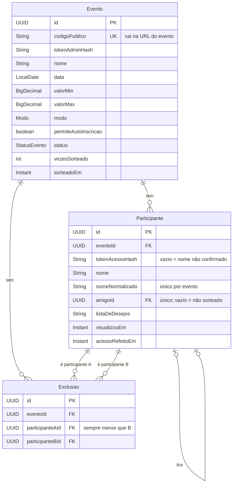

# Modelo de Dados: MVP do Sorteio de Amigo Oculto

**Feature Branch**: `001-mvp-sorteio`

**Spec**: [spec.md](./spec.md)

## Diagrama

## Enums

- **Modo**: `CLASSICO`, `AMIGO_DA_ONCA`
- **StatusEvento**: `ABERTO`, `SORTEADO`

## Restrições no Banco

| Restrição | Garante |
|---|---|
| `UNIQUE (codigo_publico)` | Cada link de evento é único. |
| `UNIQUE (evento_id, nome_normalizado)` | Sem nomes duplicados no mesmo evento, ignorando acentos e maiúsculas. |
| `UNIQUE (amigo_id)` | Cada participante é tirado no máximo uma vez. |
| `UNIQUE (participante_a_id, participante_b_id)` com `CHECK (participante_a_id < participante_b_id)` | Uma exclusão mútua é guardada uma única vez. |
| `CHECK (valor_min <= valor_max)` e ambos `>= 0` | Faixa de valor coerente. |
| `ON DELETE CASCADE` de `Evento` para `Participante` e `Exclusao` | Apagar o evento apaga todos os dados dele. |

## Regras de Validação

- **Evento.data**: obrigatória e no futuro no momento da criação.
- **Evento.valorMin / valorMax**: opcionais; quando informados, seguem as restrições acima.
- **Participante.nomeNormalizado**: derivado de `nome`, sem acentos, em minúsculas e sem espaços nas pontas.
- **Participante.listaDeDesejos**: texto livre de até 500 caracteres.
- **Participante.amigoId**: nunca igual ao próprio `id`, nunca apontando para um participante com quem há exclusão, e sempre de um participante do mesmo evento.
- **Exclusao**: os dois participantes pertencem ao mesmo evento da exclusão.
- **Tokens**: `tokenAdminHash` e `tokenAcessoHash` guardam apenas o hash SHA-256 do token; o token em si nunca é persistido.

## Transições de Estado do Evento

| De | Para | Ação | Efeitos |
|---|---|---|---|
| — | `ABERTO` | Criar evento | `vezesSorteado = 0`. |
| `ABERTO` | `SORTEADO` | Sortear | Preenche `amigoId` de todos os participantes, incrementa `vezesSorteado` e registra `sorteadoEm`. Participantes e exclusões ficam bloqueados para edição. |
| `SORTEADO` | `ABERTO` | Refazer sorteio | Limpa `amigoId` e `visualizouEm` de todos os participantes e reabre a edição de participantes e exclusões. Quando `vezesSorteado > 1`, os participantes veem o aviso de sorteio refeito. |
